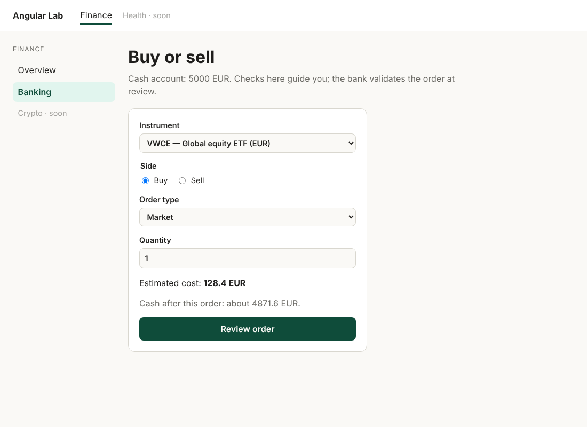
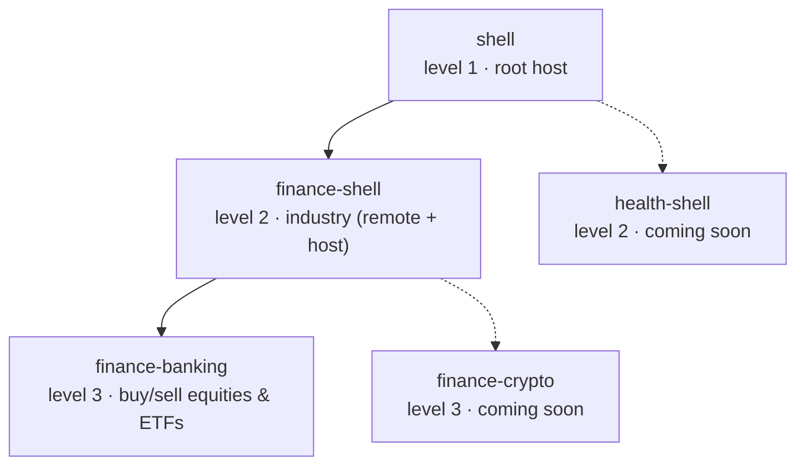
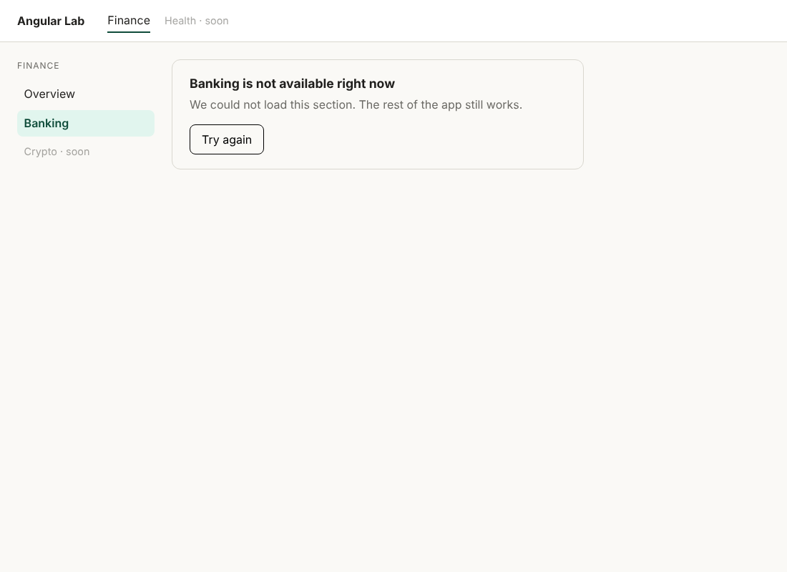

# Angular Lab

A **hierarchical micro-frontend** workspace in modern Angular (v22): a root shell loads one micro-frontend per industry, and each industry is itself a host for its own products. Every feature is specified, built, reviewed and tested by the agents of [angular-agent-factory](https://github.com/Horizon-Code/angular-agent-factory), with a human accountable for what ships.



## Architecture



| Level | App | Port | Role |
|---|---|---|---|
| 1 | `shell` | 4200 | Root host. Initialises Native Federation once and loads industries from `federation.manifest.json`. |
| 2 | `finance-shell` | 4201 | Industry micro-frontend. Exposed to the root as `./routes`, and a host for finance products, resolved from its own `finance.manifest.json`. |
| 3 | `finance-banking` | 4202 | Product: order ticket for equities and ETFs. Exposed to the Finance shell as `./routes`. |

Adding an industry is adding a sibling level-2 app; it never touches another industry. Each app deploys on its own and also runs standalone.

### Decisions worth reading

- **One federation runtime.** Only the bootstrapped app calls `initFederation()`. Its instance is provided through Angular DI (`FEDERATION` token in `@lab/shared-ui`), so a nested host registers its products with `initRemoteEntry` instead of initialising federation again. See [`load-remote-routes.ts`](libs/shared/ui/src/load-remote-routes.ts).
- **Fail soft.** If a remote is down, its host renders an error card with retry; the rest of the app keeps working.

  

- **Business rules are framework-free.** `@lab/finance-domain` holds money, currency conversion (including minor units: 100 GBp = 1 GBP), order validation and buying-power checks, with unit tests named after the rules.
- **The frontend informs, the backend decides.** The buying-power check warns ("your cash looks short") but never blocks the order; the bank's validation at review is final. Rules the client can fully verify (whole quantity, tick size, available position) do block.
- **Modern Angular only.** Standalone, zoneless, OnPush, signals, signal inputs, built-in control flow, `inject()`.

## Run it

```bash
npm install
npm start          # serves shell (4200), finance-shell (4201) and finance-banking (4202)
```

Open http://localhost:4200 and go to **Finance → Banking**. Each micro-frontend can also run alone: `npx ng serve finance-banking`.

```bash
npm test           # domain rules + component tests (Vitest)
npm run build      # builds the three apps
```

## Repository layout

```
projects/
  shell/              level 1
  finance-shell/      level 2 — exposes ./routes, hosts finance products
  finance-banking/    level 3 — exposes ./routes
libs/
  finance/domain/     money, orders, buying power (pure TypeScript + tests)
  shared/ui/          remote loading, error card, design tokens
.claude/agents/       spec-writer, implementer, reviewer, tester (from the factory)
.factory/             house rules, workflow and knowledge the agents follow
specs/                one spec per feature, written before the code
```

## Roadmap

- [x] Three-level federation: shell → finance-shell → finance-banking, with fail-soft loading
- [x] Finance domain: money, currency conversion, order validation, buying-power warning
- [ ] Mock API with named scenarios (accepted, rejected, server error, network error, slow, empty)
- [ ] Banking: review step with server validation, consent, confirmation, order list (modify / cancel)
- [ ] Playwright E2E per acceptance criterion; CI preview deploys
- [ ] `finance-crypto` (level 3) — then the next industry, chosen by demand

## License

MIT
